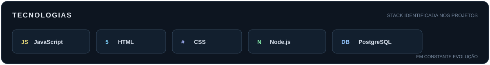

 

 

 

---

**Construindo com intenção. Aprendendo continuamente.**

Perfil atualizado automaticamente • Gráficos SVG autorais • Tema grafite suave, sem animações

<strong>Automação do calendário de contribuições</strong>

O gráfico é atualizado diariamente pelo GitHub Actions.

- Secret necessário: `GH_TOKEN`
- Permissão do token: leitura dos dados do perfil (`read:user`)
- Execução manual: **Actions → Update profile contribution graphic → Run workflow**

Nunca coloque tokens diretamente nos arquivos do repositório.

