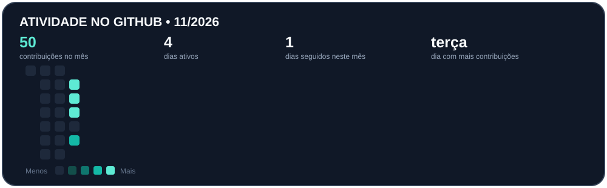

  

  

  

  

SVGs independentes, animações leves e respeito à preferência por movimento reduzido. O calendário mensal é atualizado diariamente pelo GitHub Actions.

### Ativar atualização das contribuições
1. Crie um token pessoal do GitHub com acesso de leitura a dados do perfil.
2. No repositório, abra **Settings → Secrets and variables → Actions → New repository secret**.
3. Salve o token com o nome `GH_TOKEN`.
4. Em **Actions**, execute **Update profile contribution graphic** uma vez para testar.
